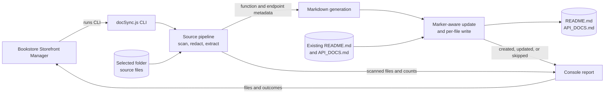
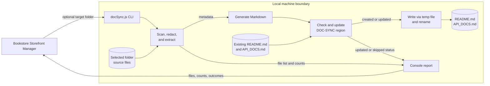

# Architecture

## Overview

The documentation synchronizer is a local Node.js CLI. The **Bookstore Storefront Manager** runs `docSync.js` with an optional target folder; without one, the CLI uses `./bookstore-web-app`. It scans JavaScript source files, extracts function and endpoint documentation, redacts the sensitive values named by the requirements, then creates or updates generated sections in `README.md` and `API_DOCS.md`.

The current implementation is concentrated in [`docSync.js`](../../docSync.js). Its default target contains [`server.js`](../../bookstore-web-app/server.js) and nested browser code such as [`public/app.js`](../../bookstore-web-app/public/app.js). Synchronization uses local filesystem operations and does not call an external service.

## Goals and Constraints

- Keep generated API and project documentation in sync with JavaScript source.
- Preserve human-authored content outside DOC-SYNC marker pairs.
- Create either output document when it does not exist.
- Redact `DB_PASSWORD`, `JWT_SECRET`, and `API_TOKEN` values before generated output or source-derived reporting.
- Report the scanned source files and whether each output was created, updated, or skipped.
- Operate locally with Node.js; this design does not add a remote synchronization service.
- Extraction is limited to the source patterns implemented by the CLI. Requirements leave broader JSDoc and route-framework coverage open.

## Components

- **Bookstore Storefront Manager:** Invokes the CLI and reads its report.
- **CLI entry point (`docSync.js`):** Resolves the optional positional folder argument or the repository-relative default, validates the target, and coordinates the synchronization.
- **Source scanner (`collectJavaScriptFiles`):** Recursively finds `.js` files and excludes `.git` and `node_modules`.
- **Extractor (`extractFunctions`, `extractEndpoints`):** Reads source text and extracts supported exported/JSDoc-documented functions and supported HTTP endpoint patterns.
- **Redactor (`redactSensitive`):** Redacts assignments for the three named secret keys before extraction and redacts output before writing.
- **Markdown generator (`generateDocumentation`):** Produces the README overview and API endpoint/function sections in stable sorted order.
- **Marker-aware updater (`renderDocument`):** Creates missing documents with markers, updates only the section between a single valid marker pair, or skips an existing document whose markers are invalid.
- **Writer (`atomicWrite`):** Writes each created or updated document through a temporary file and rename.
- **Console reporter:** Lists scanned files, discovery counts, output statuses, and warnings/errors.
- **Local project files:** JavaScript source files and the `README.md` and `API_DOCS.md` outputs under the selected folder.

## Component Diagram

## Data-Flow Diagram

## Interfaces

- **Command:** `node docSync.js [targetFolder]`. The argument is optional; the default is the repository's `bookstore-web-app` directory.
- **Source input:** Recursive local `.js` files under the selected folder; `.git` and `node_modules` directories are excluded.
- **Documentation outputs:** `README.md` and `API_DOCS.md` in the selected folder.
- **Marker contract:** Existing output files are changed only when exactly one ordered `<!-- DOC-SYNC-START -->` / `<!-- DOC-SYNC-END -->` pair is present. Missing output files are created with a marker pair.
- **Report:** Local console output lists scanned JavaScript files, discovered function and endpoint counts, and each output's created, updated, or skipped status.
- **External interfaces:** None are needed for synchronization.

## Data Flows

1. The manager runs the CLI with an optional target folder.
2. The CLI resolves the target and scans its JavaScript files. The current default target includes `server.js` and nested `public/app.js`.
3. Source text is redacted for `DB_PASSWORD`, `JWT_SECRET`, and `API_TOKEN`, then passed to function/JSDoc and endpoint extraction.
4. Extracted metadata is sorted and rendered as Markdown for both documentation outputs.
5. Each existing output is read and checked for valid markers. The updater replaces only the generated section; it creates a missing output with markers or skips an existing invalid-marker file.
6. Each eligible output is written locally, and the reporter displays scan and output statuses to the manager.

## Failure Handling

- A missing or non-directory target is reported as an error and returns a non-zero status before output files are processed.
- A valid but empty target produces an explicit no-JavaScript-files report and empty generated sections; missing output files can still be created.
- Source read, generation, and write errors are reported by the CLI, which returns a non-zero status.
- An existing document with missing, duplicated, or reversed markers is not overwritten; it is skipped with a warning.
- Each output is individually written through a temporary file and rename. This avoids writing a partially formed individual document, but the two output files are not committed as a single filesystem transaction.
- Secret values for the named keys are redacted before generated content is written or reported.

## Security and Privacy

- All processing is local; source files and generated documentation are not sent to a remote synchronization service.
- The redactor processes source text before extraction and output content before file writes. The named sensitive values are represented as `[REDACTED]`.
- Reports contain file names, counts, and output statuses rather than source contents.
- Files outside the selected target and outside generated marker regions are not written by the synchronizer.

## Design Decisions

- **One local CLI:** Reuse the repository's `docSync.js` entry point instead of introducing a service or additional runtime dependency.
- **Default target with optional override:** Follow the approved target selection while retaining the existing optional folder argument.
- **Recursive scan with exclusions:** Match the current scanner behavior and include nested files such as `public/app.js`, while avoiding dependencies and Git metadata.
- **Redact before extraction:** Apply redaction to source text before function and endpoint metadata is generated.
- **Marker-preserving outputs:** Create missing outputs with markers; update only a valid generated region; preserve and report invalid existing files.
- **Per-file safe writes:** Use the current temporary-file-and-rename behavior for each eligible output. This does not imply a transaction spanning both output documents.
- **No runtime bookstore changes:** The bookstore web application's serving and catalog behavior is outside the documentation-sync flow.
- **Extraction boundaries remain explicit:** The current CLI supports particular source patterns; exact JSDoc fields, route framework coverage, and any additional sensitive keys remain open in the approved requirements.

## Requirements Traceability

| Requirement | Architecture support |
| --- | --- |
| FR-1 | CLI resolves the repository-relative `./bookstore-web-app` default. |
| FR-2 | `collectJavaScriptFiles` scans `.js` files under the selected folder. |
| FR-3 | `extractFunctions` extracts supported exported functions and JSDoc comments. |
| FR-4 | `extractEndpoints` handles the required `GET`, `POST`, `PUT`, and `DELETE` methods. |
| FR-5 | `generateDocumentation` prepares README and API documentation sections. |
| FR-6 | `renderDocument` creates a missing output with DOC-SYNC markers. |
| FR-7 | `renderDocument` updates only a valid marker region and preserves content outside it. |
| FR-8 | `redactSensitive` redacts the three named keys before generated content is written or reported. |
| FR-9 | The console reporter lists scanned files, counts, and output statuses. |
| FR-10 | The CLI reports invalid targets and safely handles a valid empty folder. |
| NFR-1 | Synchronization uses local Node.js and filesystem operations only. |
| NFR-2 | Named secret values are redacted before generated output and source-derived reporting. |
| NFR-3 | Existing content outside valid DOC-SYNC markers is preserved. |
| NFR-4 | Missing and empty target-folder cases produce explicit reports rather than unhandled exceptions. |
